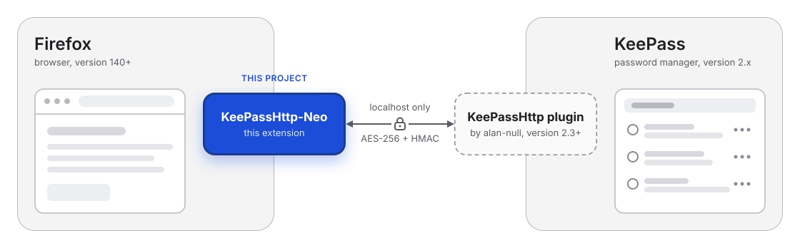

<div align="center">

# KeePassHttp-Neo

**Fill your KeePass logins in Firefox, with a security-first rewrite of KeePassHttp-Connector.**

[](LICENSE.md)
[](#requirements)
[](#privacy)

</div>

KeePassHttp-Neo is a Firefox extension. It finds login forms on web pages and fills them with entries from your [KeePass](https://keepass.info) database. It talks to KeePass through the [KeePassHttp](https://github.com/alan-null/keepasshttp) plugin, on your own computer only.

<p align="center"></p>

It is a modified version of [KeePassHttp-Connector](https://github.com/smorks/keepasshttp-connector), which is no longer maintained. This version fixes security problems, removes old libraries and adds automated tests. See the [closed issues](https://github.com/odyodyodys/keepasshttp-neo/issues?q=is%3Aissue+is%3Aclosed) for the full list of changes.

## Contents

- [Highlights](#highlights)
- [Requirements](#requirements)
- [Installation](#installation)
- [Quick start](#quick-start)
- [Usage](#usage)
- [Settings](#settings)
- [How it works](#how-it-works)
- [Security](#security)
- [Privacy](#privacy)
- [Should I use it?](#should-i-use-it)
- [FAQ and troubleshooting](#faq-and-troubleshooting)
- [Development](#development)
- [Contributing](#contributing)
- [License and credits](#license-and-credits)

## Highlights

- **Fill logins** from KeePass: from a dropdown under the username field, the toolbar popup, the right-click menu or a keyboard shortcut.
- **Save logins**: after you submit a form, the extension offers to add a new entry or update an existing one.
- **Password generator**: a key icon in password fields asks KeePass for a new password.
- **Choose fields yourself** on pages where the login form is not found automatically.
- **HTTP Basic Auth**: fill the browser's login dialog.
- **Safer by design**: passwords stay inside the extension until you fill one, and the injected UI is hidden from web pages. More in [Security](#security).
- **Works with non-English text**: usernames, passwords and URLs are UTF-8 in both directions.
- **No data collection**, no online calls, and no third-party code in web pages.

## Requirements

| Part | Version |
|---|---|
| Firefox (desktop) | 140 or newer |
| [KeePass](https://keepass.info) | 2.x |
| [KeePassHttp plugin](https://github.com/alan-null/keepasshttp) (alan-null) | 2.3.0 or newer (the extension requires its HMAC check) |

Not supported:
- **Chrome and other Chromium browsers.** The extension uses Manifest V2, which Chrome no longer runs.
- **KeePassXC.** It removed KeePassHttp support in version 2.4.
- **The original KeePassHttp plugin** by pfn. It does not send the HMAC this extension requires.

## Installation

This extension is not published on addons.mozilla.org yet. Install it from the source code.

1. **KeePass plugin**: download `KeePassHttp.plgx` from the [alan-null/keepasshttp releases](https://github.com/alan-null/keepasshttp/releases). Copy it into the `Plugins` folder of KeePass, then restart KeePass.
2. **Disable the original KeePassHttp-Connector** if it is installed. Both would try to fill the same login fields.
3. **Load the extension:**
   - Get the code: `git clone https://github.com/odyodyodys/keepasshttp-neo.git`
   - In Firefox, open `about:debugging#/runtime/this-firefox`.
   - Click **Load Temporary Add-on…** and choose `src/manifest.json`.

A temporary add-on is removed when Firefox closes. For a permanent install, the extension must be signed by Mozilla (see [Build a package](#build-a-package)).

## Quick start

1. Open KeePass and unlock your database.
2. Click the extension's icon in the Firefox toolbar, then click **Connect**.
3. KeePass shows a dialog for the new connection. Give it a name, for example "Firefox laptop", and confirm.
4. Open a login page whose URL matches an entry in KeePass. Click the username field and choose a login from the dropdown.

The connection key is stored in your KeePass database and in the extension. You can remove it from the extension's settings at any time.

## Usage

| Action | How |
|---|---|
| Fill username and password | Choose from the dropdown, the toolbar popup, the right-click menu (**Fill User + Pass**), or press `Alt+Shift+U` |
| Fill the password only | Right-click menu (**Fill Pass Only**), or press `Alt+Shift+P` |
| Generate a password | Click the key icon in a password field. A copied password is removed from the clipboard after 30 seconds. |
| Save a new or changed login | Submit the form. The toolbar icon blinks; open it and click **New** or **Update**. |
| Pick the login fields yourself | Toolbar popup → **Choose own credential fields for this page** |
| Fill extra fields | Choose the fields yourself, and turn on string fields in the KeePassHttp plugin options (see the [user guide](documentation/KeePassHttp-Connector.md#37-fill-in-additional-values-via-string-fields)) |

You can change the shortcuts in Firefox: `about:addons` → gear icon → **Manage Extension Shortcuts**.

To update an existing entry, turn on **Always allow updating entries** in the KeePassHttp plugin options in KeePass (Advanced tab). New entries are created in the group "KeePassHttp Passwords".

## Settings

Open the settings from the toolbar popup, or from the extension's page in `about:addons`.

| Setting | Default | What it does |
|---|---|---|
| Automatically retrieve credentials | On | Ask KeePass for logins when a page opens |
| Activate autocomplete for username fields | On | Show the login dropdown under username fields |
| Automatically fill-in single credentials entry | Off | Fill without asking when KeePass returns exactly one login |
| Activate password generator | On | Show the key icon in password fields |
| Auto fill HTTP Auth dialogs and send them | Off | Send Basic Auth logins without asking (on https pages only) |
| Respect maxlength attribute | Off | Cut filled values to the field's maximum length |
| Supress warnings and errors via alert | On | Do not show warnings and errors as page alerts |
| Port | 19455 | Must match the port in the KeePassHttp plugin options |

The settings page also lists your **connected databases**. Give each one its own toolbar icon color, from the presets or as a `#rrggbb` value, to see at a glance which database is in use. It also lists the **fields you chose** per site. You can remove connections and fields there.

## How it works

```
 Web page                    Extension background              KeePass
┌──────────────┐  messages  ┌────────────────────────┐  HTTP   ┌──────────────────┐
│ content script│ ────────► │ checks sender and page │ ──────► │ KeePassHttp      │
│ (finds fields,│ ◄──────── │ AES-256 + HMAC         │ ◄────── │ plugin           │
│  shows UI)    │  names,   │ keeps passwords        │ local-  │ (localhost only) │
└──────────────┘  then one  └────────────────────────┘ host    └──────────────────┘
                  password
                  on fill
```

1. The content script finds login fields and asks the background for logins.
2. The background takes the page address from Firefox, not from the page. It asks KeePass for matching entries over `http://localhost`. Every request and response is encrypted with AES-256 and checked with an HMAC.
3. The page receives only the login names. When you choose a login, the background sends that one password to that one page and frame.

## Security

Main protections in this version:

- Keys and IVs come from the browser's secure random generator (WebCrypto).
- The extension connects only to `localhost`. Responses without a valid HMAC are rejected.
- Passwords stay in the background until you fill one.
- The dropdown, password generator and field chooser live in closed shadow roots. Web pages cannot read or click them, and they work under strict Content Security Policies.
- Only real user actions fill a login. Scripted clicks and key presses are ignored.
- Frames from another site, and sandboxed frames, get no logins.
- No automatic fill on pages without https. You see a red warning, but you can still fill by hand.
- Cached logins are dropped when KeePass locks or the tab moves to another site.
- Logs never contain keys, passwords, usernames or URLs.

Limits you should know:

- KeePassHttp is an old protocol. Any program on your computer can try to connect to the plugin's port. KeePass asks you before it accepts a new connection, so read that dialog with care.
- The plugin decides which entries match a page. Keep the URLs in your entries exact.

**Reporting a vulnerability:** please do not open a public issue. Use [GitHub private vulnerability reporting](https://github.com/odyodyodys/keepasshttp-neo/security) for this repository.

## Privacy

The extension collects no data and sends nothing to the internet. It talks only to the KeePassHttp plugin on your own computer. Settings and the connection key are stored in Firefox's local extension storage.

## Should I use it?

**Use it if** you use KeePass 2 with the KeePassHttp plugin on Firefox, and want a maintained, hardened extension for it.

**Consider other tools if** you can change your setup. [KeePassXC](https://keepassxc.org) with [KeePassXC-Browser](https://github.com/keepassxreboot/keepassxc-browser), or KeePass with the [KeePassNatMsg](https://github.com/smorks/keepassnatmsg) plugin, use native messaging instead of a local HTTP port.

## FAQ and troubleshooting

**The popup shows an error, or nothing is filled.**
Check that KeePass is open, the database is unlocked, and the port in the settings matches the plugin's port.

**No logins appear on a page.**
The entry URL in KeePass must match the site. On pages without https, logins are listed but not filled automatically.

**The page form is not detected.**
Use **Choose own credential fields for this page** in the toolbar popup.

**"Update" does not change my entry.**
Turn on **Always allow updating entries** in the KeePassHttp plugin options (Advanced tab).

**Does it work in iframes?**
Yes, in frames from the same site as the page. Frames from another site get no logins, on purpose.

**Can I use it on Firefox for Android?**
No. There is no KeePass with the KeePassHttp plugin on Android.

The [user guide](documentation/KeePassHttp-Connector.md) from the original project explains more features. Parts of it are out of date: Chrome, KeePassXC, the update check and the hostname setting no longer apply.

## Development

```
src/          the extension (load src/manifest.json)
  background/ connection to KeePass, crypto, message checks
  kphc.js     content script: field detection and page UI
  popups/     toolbar popups
  options/    settings page
test/         unit and Firefox end-to-end tests (not shipped)
documentation/ user guide from the original project
```

### Run the tests

The tests need Node.js. Everything installs inside `test/`, with no global installs.

```sh
cd test
npm ci
npm run test:unit      # unit tests
npm test               # Firefox end-to-end tests with a fake KeePassHttp server
npm run lint:ext       # web-ext lint
```

The end-to-end tests start a fresh Firefox profile and use only dummy data. See [test/README.md](test/README.md) for options.

### Build a package

```sh
cd test
npx web-ext build --source-dir ../src --artifacts-dir ../dist
```

To install it permanently, sign the package with your own add-on ID through [addons.mozilla.org](https://extensionworkshop.com/documentation/publish/signing-and-distribution-overview/).

## Contributing

Bug reports and pull requests are welcome.

- Never put real passwords, keys or personal data in an issue, a log or a test. Use dummy values.
- Add or update a test for each change, and run all tests before you open a pull request.
- Keep the extension free of remote code and data collection.

## License and credits

[GNU General Public License v3](LICENSE.md).

Based on [KeePassHttp-Connector](https://github.com/smorks/keepasshttp-connector) by smorks, which was forked from [chromeIPass and PassIFox](https://github.com/pfn/passifox) by Perry Nguyen and Lukas Schulze. The KeePassHttp plugin is maintained by [alan-null](https://github.com/alan-null/keepasshttp). This project is not affiliated with KeePass.
